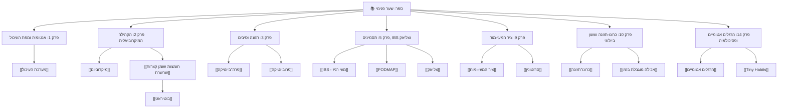

# 🧠 שער פנימי — מפת הידע והרשת (Master Knowledge Graph MOC)

ברוכים הבאים לחוט השדרה של הספר **"שער פנימי: המעי, האנרגיה והבריאות"**.
כל 19 הפרקים מעוגנים ברזולוציית בלוקים (`^block-id`), מקושרים לרשת המושגים המרכזית, וניתנים להפקת ספר, אתר או לשליפה היברידית במנוע ה-RAG.

---

## 🗺️ מפת הפרקים והרשת המקושרת

| פרק | נושא מרכזי | מושגי מפתח מקושרים | קובץ אובסידיאן |
| :--- | :--- | :--- | :--- |
| **פרק 1** | מערכת העיכול: מפת הגוף והמסע של המזון | [[מיקרוביום]], [[מערכת העיכול]] | [[chapter_01]] |
| **פרק 2** | הקהילה המיקרוביאלית | [[מיקרוביום]], [[מערכת העיכול]] | [[chapter_02]] |
| **פרק 3** | תזונה להזנת הקהילה המיקרוביאלית | [[מיקרוביום]], [[מערכת העיכול]] | [[chapter_03]] |
| **פרק 4** | תזונה יומיומית: מהמדע לצלחת ולרשימת הקניות | [[מיקרוביום]], [[מערכת העיכול]] | [[chapter_04]] |
| **פרק 5** | תסמינים נפוצים ומה עושים איתם | [[מיקרוביום]], [[מערכת העיכול]] | [[chapter_05]] |
| **פרק 6** | בדיקות ואבחון: מן התסמין לשאלה הרפואית | [[מיקרוביום]], [[מערכת העיכול]] | [[chapter_06]] |
| **פרק 7** | תרופות, תוספים ובריאות המעיים | [[מיקרוביום]], [[מערכת העיכול]] | [[chapter_07]] |
| **פרק 8** | בריאות המעיים במצבי חיים ובאוכלוסיות מיוחדות | [[מיקרוביום]], [[מערכת העיכול]] | [[chapter_08]] |
| **פרק 9** | ציר המעי–מוח, עייפות וניהול אנרגיה | [[מיקרוביום]], [[מערכת העיכול]] | [[chapter_09]] |
| **פרק 10** | המדריך לכרונו־תזונה | [[מיקרוביום]], [[מערכת העיכול]] | [[chapter_10]] |
| **פרק 11** | תזמון רכיבים תזונתיים, קפאין וביצועים ספורטיביים | [[מיקרוביום]], [[מערכת העיכול]] | [[chapter_11]] |
| **פרק 12** | שינה, לחץ ובריאות המעיים | [[מיקרוביום]], [[מערכת העיכול]] | [[chapter_12]] |
| **פרק 13** | תנועה, תנועתיות וניהול אנרגיה | [[מיקרוביום]], [[מערכת העיכול]] | [[chapter_13]] |
| **פרק 14** | פסיכולוגיה של השינוי: מהרגל קטן לבריאות מעיים לאורך זמן | [[מיקרוביום]], [[מערכת העיכול]] | [[chapter_14]] |
| **פרק 15** | כלים לשינוי דפוסים — ומה באמת מבוסס | [[מיקרוביום]], [[מערכת העיכול]] | [[chapter_15]] |
| **פרק 16** | תוכנית שבעת הימים לבריאות המעיים | [[מיקרוביום]], [[מערכת העיכול]] | [[chapter_16]] |
| **פרק 17** | ניטור, יומן מעקב אישי ומדדי אנרגיה | [[מיקרוביום]], [[מערכת העיכול]] | [[chapter_17]] |
| **פרק 18** | מיתוסים, בדיקות ושיווק בבריאות המעיים | [[מיקרוביום]], [[מערכת העיכול]] | [[chapter_18]] |
| **פרק 19** | חזון הבריאות לטווח הארוך | [[מיקרוביום]], [[מערכת העיכול]] | [[chapter_19]] |

---

## 🔗 רשת מושגי הידע המרכזיים (Core Concept Nodes)

- **מערכת העיכול והאנטומיה:** [[מערכת העיכול]], [[מיקרוביום]], [[סרוטונין]], [[ציר המעי–מוח]]
- **מטבוליזם ותזונה:** [[בוטיראט]], [[חומצות שומן קצרות שרשרת]], [[פרה־ביוטיקה]], [[פרוביוטיקה]], [[FODMAP]]
- **אבחון ורפואה:** [[IBS]], [[צליאק]], [[סולם בריסטול]]
- **אורח חיים והרגלים:** [[כרונו־תזונה]], [[אכילה מוגבלת בזמן]], [[קפאין]], [[הרגלים אטומיים]], [[Tiny Habits]], [[NLP]]

---

## 📊 Mermaid Knowledge Graph Visualizer

